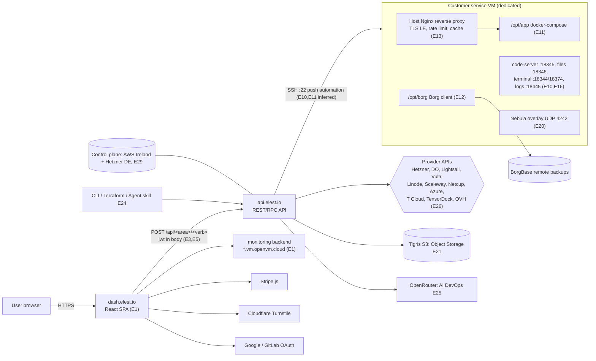
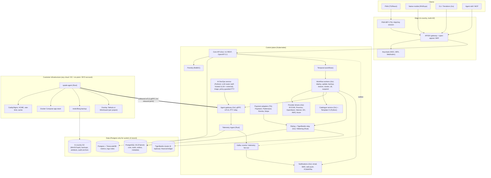
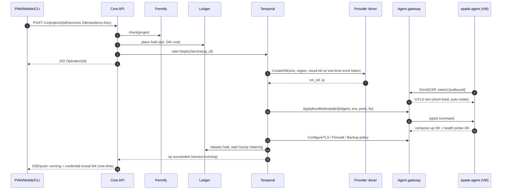
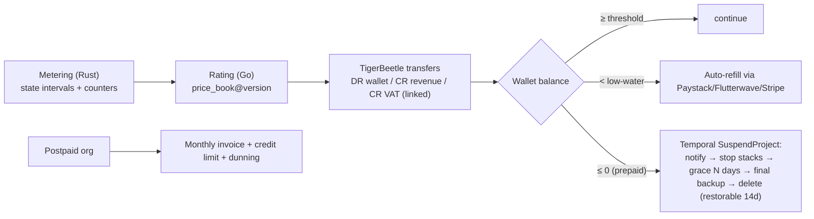
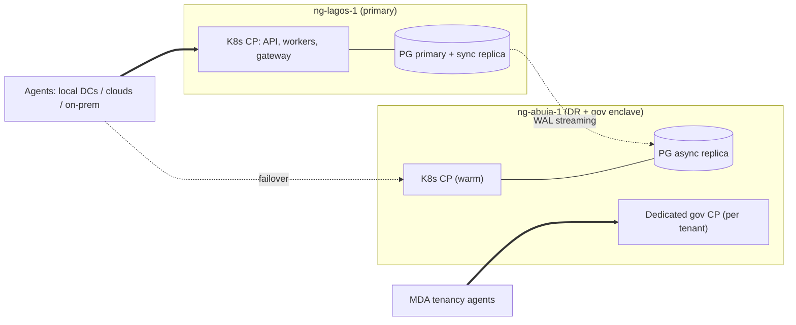

# 03 — Architecture Specification

## 1. Recovered Elestio architecture (as-is, from evidence)


**Takeaways that shape our design:**
- The **control plane is thin**: an API plus provider drivers. The **heavy lifting is per-VM convention**: fixed filesystem layout, Compose, and a host proxy.
- The catalogue (templates plus tests) is the real moat.
- The weak points we fix: auth tokens in localStorage and request bodies, inbound SSH as the management channel, the EU-hosted control plane, USD-only prepaid billing, inconsistent policy docs (W1–W6).

## 2. Target architecture: SpadeAi (to-be)


### 2.1 Language placement (and why)
| Language | Components | Rationale |
|---|---|---|
| **Go** | Core API, Temporal workers, provider drivers, agent gateway, catalogue service, rating/ledger, notifications, CLI, Terraform provider | First-class Temporal and cloud SDKs; Terraform plugin framework is Go |
| **Rust** | `spade-agent` (on every customer VM), metering aggregator, telemetry ingest | Small static binary, memory-safe on hostile hosts, high-throughput ingest |
| **Python** | Template CI/test harness, AI DevOps (LLM orchestration, policy engine), pricing/FX analytics | LLM/tooling ecosystem; test scripting |
| **TypeScript** | PWA + BFF, React Native mobile, payment adapters, SDK | Shared types from the OpenAPI spec across web and mobile |

### 2.2 Data architecture
- **PostgreSQL is the system-of-record for all non-financial state.** Schemas:
  - `core` (tenancy, services, catalogue)
  - `billing` (account map, transfer intents/outbox, invoices)
  - `audit` (hash chain)
  - `ops` (operations, idempotency, outbox)
  - `pricing` (versioned price books)
- **Postgres for third-party components too:** Temporal, Keycloak and Permify all run on Postgres (separate clusters/DBs).
- **Telemetry:** the TimescaleDB extension on a separate Postgres cluster (hypertables, compression, 30/90/400-day retention tiers).
- **Kafka** is a transport, not a store: telemetry fan-out, alert evaluation, outbox relay.
- **Object storage** holds blobs only: backups, build artefacts, audit anchors, log archives as Parquet.
- **TigerBeetle is the financial ledger (decided):**
  - Wallets, revenue, VAT and provider payables are TigerBeetle accounts.
  - Holds are pending transfers.
  - Prepaid wallets use `debits_must_not_exceed_credits`.
  - Postgres stores the account map and the transfer outbox. The relay is exactly-once via deterministic transfer IDs.
  - Deployment: 6-replica cluster in-region, with backups to in-country object storage.

## 3. Key flows
### 3.1 Deploy a catalogue service


### 3.2 Hourly billing and suspension


### 3.3 AI DevOps (guarded)
```mermaid
sequenceDiagram
  participant U as User
  participant AI as AI DevOps (Python)
  participant R as LLM router (org ai_policy)
  participant LLM as LLM backend (self-hosted vLLM or external)
  participant T as Temporal
  participant G as Gateway / agent PTY
  U->>AI: "Site returns 502"
  AI->>R: context (metrics, logs excerpt, template meta; PII-redacted)
  R->>LLM: route per policy (self_hosted | external | hybrid)
  LLM-->>R: diagnosis / needs shell?
  R-->>AI: result + backend/model/tokens (audited)
  alt answer-only
    AI-->>U: answer (1 credit)
  else needs shell
    AI-->>U: request approval
    U->>AI: approve (biometric on mobile)
    AI->>T: PreChangeSnapshot
    AI->>G: open recorded PTY (allow-list, 1h TTL)
    G-->>U: live terminal stream
    AI-->>U: summary + diff (6 credits)
  end
```

## 4. Deployment topology
- **Regions:** `ng-lagos-1` (primary, 2–3 AZs across separate DCs) and `ng-abuja-1` (DR, plus a sovereign gov enclave). An optional `af-west` edge for regional customers.
- **Control plane:** Kubernetes (RKE2/k3s on bare metal or the local cloud), GitOps via Argo CD, Postgres HA via Patroni or CloudNativePG with synchronous replica in-region and async to DR.
- **Agent gateways:** per region, anycast/DNS-balanced, horizontally scaled; agents reconnect to the nearest gateway.
- **Observability of the platform itself:** OpenTelemetry → TimescaleDB; SLO dashboards; on-call alerts to mobile.
- **Gov / BYO-account enclave:** a dedicated control-plane instance per tenant when policy requires. The operator acts through a single IAM principal inside the tenancy, so the customer audit trail is authoritative (E27 pattern).



## 5. Security architecture
- **Identity:** Keycloak realms per org type. MFA is required for privileged roles; WebAuthn is supported. Service accounts use scoped PATs.
- **AuthZ:** Permify schema `org → project → service/cluster/lb/bucket`, with relations owner, admin, operator, viewer, billing. Destructive verbs need `admin` plus re-auth.
- **Zero-trust fleet channel:**
  - Agent identity comes from an internal CA (SPIFFE-style IDs). Certs last 24h with automatic rotation.
  - Typed command protocol; commands are signed by the control plane and verified by the agent.
  - Replay protection via nonce plus expiry.
- **Secrets:** envelope encryption (Vault Transit or the cloud KMS). BYO-account uses the customer's KMS (customer-held keys).
- **Edge:** APISIX (rate limits, JWT validation via JWKS), open-appsec WAF, bot challenge on signup.
- **Audit:** hash-chained `audit.audit_event`; daily Merkle root written to WORM bucket and optionally to an external timestamping anchor.
- **Threat-model highlights:** compromised customer VM must not pivot into the control plane (agent has no inbound control-plane credentials beyond its own identity; gateway enforces per-agent ACL); compromised operator account mitigated by JIT + dual control.

## 6. Parity map: Elestio feature → SpadeAi component
| Elestio capability (evidence) | SpadeAi component | Phase |
|---|---|---|
| Catalogue 400+ templates (E28) | Catalogue svc + template repo + Template CI | P1 (top 50) → P3 (300+) |
| Deploy on providers / BYOVM (E10, E26) | Drivers + agent | P1 (BYOVM, Proxmox, Hetzner) → P2 (OpenStack, AWS, Azure, DO) |
| Power / resize / version / clone (E6, E14) | Temporal workflows + agent verbs | P1 |
| TLS, firewall, rate-limit, cache (E13) | Agent proxy + nftables | P1 |
| Backups 3-2-1 + S3 (E12) | Backup workflows + restic/Borg + in-country vault | P1 (local + remote) → P2 (snapshots, external S3, verify drills) |
| Monitoring and alerts (E15) | Telemetry ingest + TimescaleDB + alert engine + mobile push | P1 |
| Web IDE / terminal / files / logs (E16) | Agent PTY + gateway relay + on-demand code-server | P2 |
| Projects, teams, roles (E23) | Keycloak + Permify | P1 |
| Prepaid credits, hourly billing (E8) | Metering + rating + TigerBeetle ledger + payment adapters | P1 (prepaid NGN) → P2 (postpaid, USD) |
| Support plans L1–L3 (E7) | Plan entitlements in price book + helpdesk integration (Zammad, OSS) | P2 |
| CI/CD from Git (E17) | Pipeline service + builder (BuildKit) on CI target VMs | P2 |
| Clusters (E18) | Cluster workflows (Patroni for PG, Group Replication for MySQL, Sentinel/Valkey) | P3 |
| Load balancers (E19) | Managed LB (Envoy or HAProxy) driven by agent | P3 |
| Object storage (E21) | MinIO/Ceph RGW multi-tenant + quota/billing | P3 |
| Domains (E22) | Registrar partner API + DNS (PowerDNS) | P3 |
| API / CLI / Terraform / agent skill (E24) | OpenAPI-first + Go CLI + TF provider + MCP | P1 API/CLI → P2 TF/MCP |
| AI DevOps (E25) | Python AI service + guarded PTY + credits | P3 |
| Sovereign BYO-account (E27) | Tenant-scoped CP + customer KMS + IAM-principal operation | P2 (gov pilot) |

## 7. Phased delivery plan
| Phase | Scope | Exit criteria |
|---|---|---|
| **P0 Foundations** (weeks 0–4) | Repo and monorepo layout, CI, Keycloak/Permify/Temporal/Postgres, OpenAPI skeleton, TigerBeetle cluster + account map + transfer outbox, capability registry | Infra up; ledger property tests pass; `/capabilities` honest |
| **P1 MVP** (weeks 4–14) | Agent (enrol, compose, TLS, firewall, metrics, backup), BYOVM + Proxmox + Hetzner drivers, 50 templates with CI, deploy/day-2 workflows, prepaid NGN billing (Paystack + Flutterwave), PWA core, mobile alerts/actions, CLI | Deploy → backup → restore → update → delete green E2E on real VMs; TigerBeetle ↔ Postgres ↔ payment provider reconciliation zero-variance |
| **P2 Production** (weeks 14–26) | Web tools, CI/CD, external S3 + snapshots + restore drills, support plans, postpaid/government billing, Terraform + MCP, OpenStack/AWS/Azure drivers, gov BYO-account pilot, ISO 27001 readiness | First paying enterprise; DR failover drill passed |
| **P3 Scale** (weeks 26–40) | Clusters, LBs, object storage, domains, AI DevOps, 300+ templates, partner/white-label | Cluster failover chaos tests; AI DevOps DPIA approved |

## 8. Repository layout (proposed monorepo)
```
spadeai/
  api/            Go: core API, OpenAPI 3.1 source
  workers/        Go: Temporal workflows/activities
  drivers/        Go: provider drivers
  gateway/        Go: agent gateway + PTY relay
  billing/        Go rating + TigerBeetle relay; Rust metering
  agent/          Rust: spade-agent
  telemetry/      Rust: ingest
  ai-devops/      Python
  templates/      catalogue (spade.yml + compose + tests) + Python template CI
  apps/pwa/       TS React PWA + BFF
  apps/mobile/    RN/Expo
  cli/  terraform-provider/  mcp/
  db/migrations/  Postgres (core, billing, audit, ops, pricing)
  deploy/         Helm/Argo CD, Patroni/CNPG, Keycloak realms, Permify schema
  docs/specs/     these documents
```

## 9. Decisions
| # | Decision | Status |
|---|---|---|
| 1 | Product name: **SpadeAi**; repo `munisp/spadeAi` | Decided |
| 2 | Private network: **both Nebula and WireGuard**, selectable per project; the agent abstracts the overlay | Decided |
| 3 | AI DevOps LLM: **runs on both**, self-hosted (vLLM, open-weight, in-country) and external providers, routed per org `ai_policy` (`self_hosted` / `external` / `hybrid`); residency-bound tenants locked to self-hosted | Decided |
| 4 | Financial ledger: **TigerBeetle**; Postgres for everything else | Decided |
| 5 | Legal entity, `.ng` registrar partner, first 2–3 Nigerian infrastructure partners | Open |
